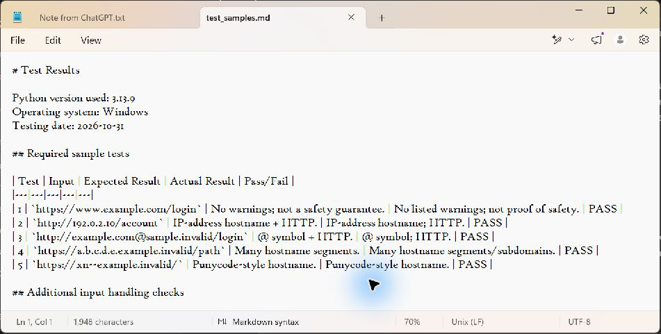

# EWB Phishing URL Awareness Checker

## Overview

Phishing uses fake links or messages to trick people into sharing private information. This beginner-friendly Python command-line program reads URL text and reports six visible warning signs without visiting the URL or sending it anywhere.

The results are clues for careful review, not a verdict about whether a link is safe or malicious.

## Features

- Detects an `@` symbol in the URL text.
- Flags URLs longer than 100 characters.
- Flags a hostname written as a four-part numeric address.
- Flags hostnames with five or more dot-separated parts.
- Flags the `xn--` punycode marker in a hostname.
- Flags the `http` scheme.
- Lets the user check more than one URL in one run; enter `q`, `quit`, or `exit` to stop.
- Shows a `REVIEW CAREFULLY` summary when warning signs are found.
- Returns a readable message for empty input and malformed URL text.

## Requirements

- Python 3.10 or later.
- No extra packages. The program uses Python's built-in `re` and `urllib.parse` modules.

## How to Run

Open a terminal in the `phishing-url-awareness` folder and run:

```text
python phishing_checker.py
```

On macOS or Linux, use:

```text
python3 phishing_checker.py
```

Enter a sample URL from the workbook. To finish, type `q` and press Enter.

## Example Output

This example uses the workbook's sample `http://192.0.2.10/account`:

```text
EWB Phishing URL Awareness Checker
Text checks only - this program does not open URLs.

Enter a sample URL (or type q to quit): http://192.0.2.10/account

Result:
- Uses an IP address instead of a familiar domain.
- Uses HTTP. HTTPS alone does not prove trust.

REVIEW CAREFULLY: 2 warning sign(s) found.

Never enter passwords from unexpected links.

Enter a sample URL (or type q to quit): q
Goodbye! Stay alert online.
```

## Testing

All five sample URLs from Section 08 were run through the program with Python 3.13.9 on Windows on 2026-10-31. All five produced the expected warnings or information message. Empty input, the workbook's malformed input example, and the repeat-and-quit flow were also checked. The actual results are recorded in [`tests/test_samples.md`](tests/test_samples.md).

The required five samples do not include a URL longer than 100 characters, so the length warning is implemented as specified but is not exercised by that five-row sample suite.

## Screenshots

The genuine screenshot of the completed five-test table is included as `screenshots/test_results.png`. The sample-run screenshot is still pending and must be captured from a terminal before final submission:

1. Run the program in a terminal with `http://192.0.2.10/account` and capture the terminal area showing the command, input, and output as `screenshots/sample_run.png`.
2. The completed test table is captured in `screenshots/test_results.png`.

Do not create substitute images or present an image as proof of a run that did not happen.

The sample-run screenshot will appear here after it is captured and saved as `screenshots/sample_run.png`.



## Improvements

1. **Continuous checking with a quit command:** A loop accepts more sample URLs until the user enters `q`, `quit`, or `exit`. This makes demonstrations easier because the program does not need to restart for each sample. I checked that two workbook samples produced separate results in one run and that `q` exited cleanly.
2. **Review summary:** When findings contain warning signs, the program prints `REVIEW CAREFULLY` and the number of warning signs. This gives the user a clear next step without calling the URL malicious. I checked the summary against the sample results that produce one or more warnings.
3. **Malformed-input handling:** URL parsing is wrapped in `try`/`except` so text such as the workbook's `http://[bad` example returns a clear message instead of stopping the program. I ran that example and confirmed the program continued to the next prompt.

## Limitations

This is an educational tool that only reads URL text. It does not open URLs, scan websites, check reputation services, detect malware, or prove that a URL is safe. No listed warning signs does NOT mean a URL is safe. Some legitimate URLs can contain these clues, and harmful URLs can avoid all six checks.

## Ethical Use

Use only the sample strings provided in the workbook. Do not visit suspicious links, scan or probe websites, collect credentials, send URLs to an external service, or use the project to deceive anyone. Do not claim that it definitively identifies malicious URLs.

## Author

EWB Courses student mini project.

## Viva Preparation

- **What is phishing?** A trick using fake links or messages to get people to share passwords, payment details, or other private information.
- **What is a URL?** The full text address of a web page, such as `https://www.example.com/login`.
- **What is a hostname?** The name in a URL that identifies the computer or service, such as `www.example.com`.
- **Why is `@` a warning sign?** Text before `@` can look like the destination, while the hostname after it is the part a browser uses.
- **Why can an IP address be a warning sign?** A bare number can hide which organization operates the destination; it is a clue, not proof.
- **What is punycode?** A way to represent some international characters using ordinary letters and numbers. Hostname labels may start with `xn--`.
- **What is the difference between HTTP and HTTPS?** HTTPS encrypts the connection; HTTP does not. HTTPS alone does not prove that a site is honest.
- **What is a regular expression?** A short text pattern used to find a shape, such as four groups of digits separated by dots.
- **What does `urlparse()` do?** It splits URL text into parts such as the scheme, hostname, and path; it does not visit the URL.
- **What is a Python function?** A named, reusable block of code that can take input and return a result.
- **Why use `if __name__ == "__main__"`?** It calls `main()` when this file is run directly, but not when another Python file imports it.
- **Does the application open URLs?** No. It only inspects the text typed by the user.
- **Does no warning mean a URL is safe?** No. The program checks only six clues, so a harmful link can have none of them.
- **What improvements were implemented?** A loop with a quit command, a `REVIEW CAREFULLY` count, and a clear response for malformed input. Each was checked with workbook sample or bonus input strings.

## Publish on GitHub

Follow these steps for a GitHub submission or to verify the public repository:

1. In GitHub, create or open a repository named `phishing-url-awareness` with the description `Python tool that checks URL text for phishing warning signs (educational project).` Set visibility to **Public**. If creating it from scratch, leave the automatic README option off.
2. Use GitHub's **Upload files** page to add `phishing_checker.py`, `README.md`, `requirements.txt`, and the `tests/` and `screenshots/` folders from this project directory. Keep the folder and file names unchanged. Commit with the message `Submit cybersecurity mini project`.
3. Check that the repository root contains the three files and two folders, that `tests/test_samples.md` is present, and that both PNGs are inside `screenshots/`.
4. Open the repository README and confirm both screenshots appear. If they do not, check the image paths and file names.
5. Open the repository link in a private/incognito browser window and confirm it loads without signing in.
6. Copy the public repository URL from the browser address bar for submission.
